> 🌐 [English](README.md) · **Español**

# Cartero

[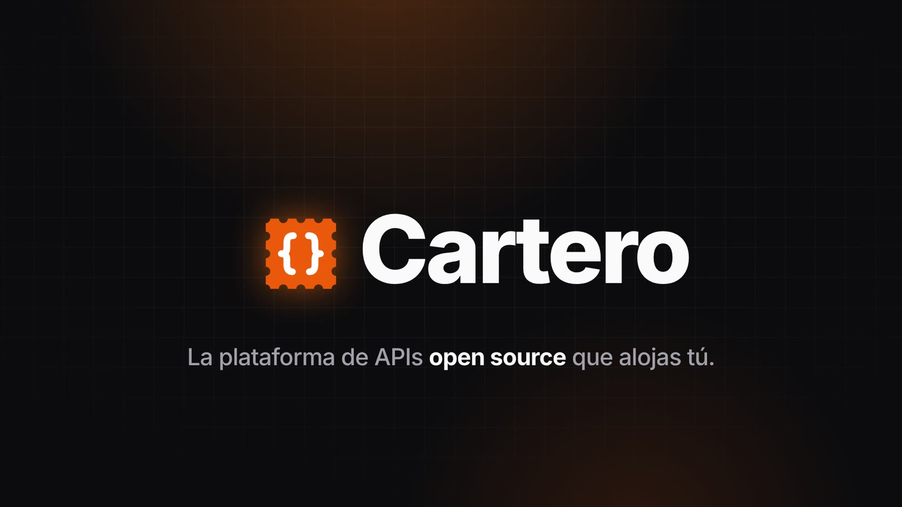](https://github.com/elrincondeisma/cartero/raw/main/apps/landing/public/video/cartero-es.mp4)

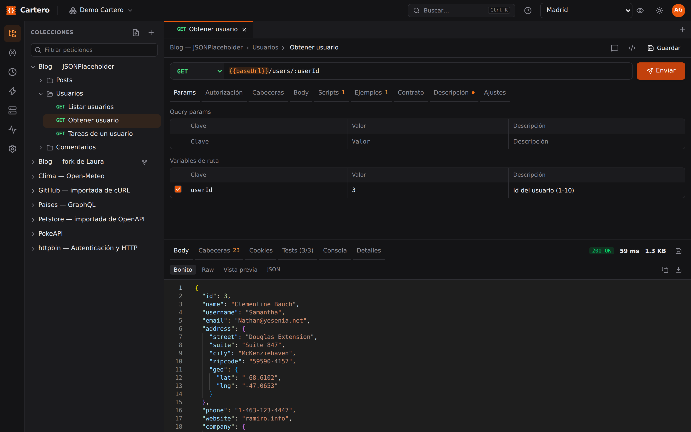

**App de escritorio:** [macOS](https://github.com/elrincondeisma/cartero/releases/latest/download/Cartero-macos-universal.dmg) · [Windows](https://github.com/elrincondeisma/cartero/releases/latest/download/Cartero-windows-x64-setup.exe) · [Linux .deb](https://github.com/elrincondeisma/cartero/releases/latest/download/cartero-linux-amd64.deb) · [Linux AppImage](https://github.com/elrincondeisma/cartero/releases/latest/download/Cartero-linux-x86_64.AppImage)

**Cliente de APIs web y open source, autoalojado.** Una alternativa a Postman con lo que allí es de pago incluido gratis y sin límites: runner de colecciones, mock servers, monitores, documentación publicada y colaboración en equipo. Importa tus colecciones de Postman sin perder nada.

> MIT · TypeScript · Un `docker compose up` y listo

## Qué incluye

| | |
|---|---|
| **Peticiones** | REST y GraphQL; params, cabeceras, body (raw/JSON/XML, form-data con ficheros, urlencoded, binario); historial; cookies; snippets de código en más de 20 lenguajes |
| **Autenticación** | Basic, Bearer, API Key, JWT, Digest, OAuth 1.0, **OAuth 2.0** (Authorization Code + PKCE, Client Credentials, Password, Implicit, refresco), Hawk, AWS SigV4, NTLM, Akamai EdgeGrid; herencia carpeta → colección |
| **Scripts** | Pre-request y post-response con la API `pm.*` de Postman (ejecutados con `postman-runtime`): `pm.test`, `pm.expect`, `pm.sendRequest`, `pm.environment`, `setNextRequest`… con autocompletado |
| **Variables** | Globales, de colección, de carpeta, entornos y datos de iteración. Las variables secretas se cifran en reposo (AES-256-GCM) |
| **Importar / exportar** | Postman (colecciones v1, v2.0 y v2.1, entornos, globales, volcado de datos y ZIP de exportación), Insomnia (v4 JSON y v5 YAML), OpenAPI 3.0/3.1, Swagger 2.0 y cURL. Exporta a Postman v2.1 (ida y vuelta sin pérdidas) |
| **Runner** | Ejecuta colecciones o carpetas sin límites, con iteraciones, datos CSV/JSON, retardo, «parar al primer fallo» y resultados en vivo |
| **CLI** | `cartero run`, equivalente a Newman, para CI: reporters de consola, JSON, JUnit y HTML; ejecuta ficheros o colecciones de tu servidor y sube el resultado |
| **Contratos** | La estructura que envía el frontend y la que debe devolver el backend, por código de estado. Se generan desde una respuesta real o se escriben a mano; se comprueban en cada envío, avisan de los cambios que rompen al guardar, alimentan el mock y se exportan e importan como OpenAPI 3.1. Mira la [guía](docs/manual/es/19-contratos.md) |
| **Mock servers** | Responden con los ejemplos guardados: rutas con parámetros, cabeceras `x-mock-response-*`, variables dinámicas (`{{$randomEmail}}`…), retardo simulado, mocks privados y log de llamadas |
| **Monitores** | Ejecuciones programadas con cron y zona horaria; avisos por Slack, Discord, Telegram, email o webhook; historial con disponibilidad y tiempos |
| **Documentación** | Página pública por colección con descripciones en Markdown, ejemplos y cURL. Opcionalmente con contraseña. Las credenciales se ocultan solas |
| **IA (MCP)** | Servidor MCP integrado (`/mcp`) con 24 herramientas: Claude, Cursor y otros asistentes pueden explorar, enviar, ejecutar, crear peticiones, importar y gestionar contratos con tus permisos |
| **Idiomas** | Interfaz, manual y datos de ejemplo en **español e inglés**, con selector de idioma guardado en tu cuenta |
| **Ayuda** | Asistente de bienvenida, recorrido guiado, paleta de comandos (Ctrl+K), [manual completo](docs/manual/es/README.md) en `/ayuda` y datos de ejemplo con APIs reales que se quitan con un clic |
| **Equipos** | Workspaces, invitaciones, roles (propietario, admin, editor, lector), presencia en tiempo real, comentarios, historial de cambios con restauración, fork y merge, tokens de API |
| **Acceso y administración** | Email y contraseña, **Google** y **GitHub**. **Asistente de instalación** paso a paso al primer arranque, y un panel de administración con todos los ajustes: cuentas y roles, registro, OAuth, email (SMTP) y protección SSRF |

## Capturas

<table>
  <tr>
    <td width="50%" valign="top">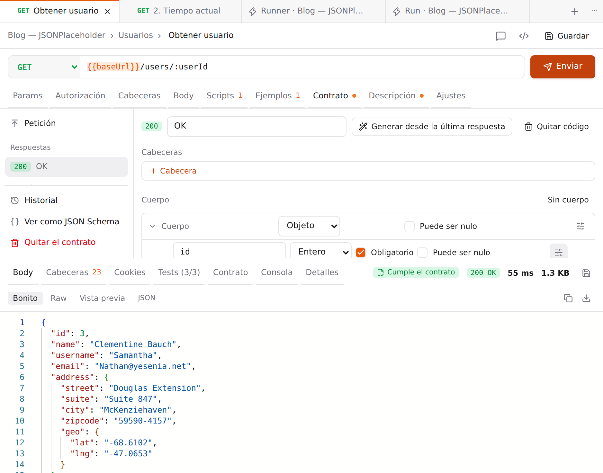<br><b>Contratos de API</b> · generados desde una respuesta real y editados como árbol de campos</td>
    <td width="50%" valign="top">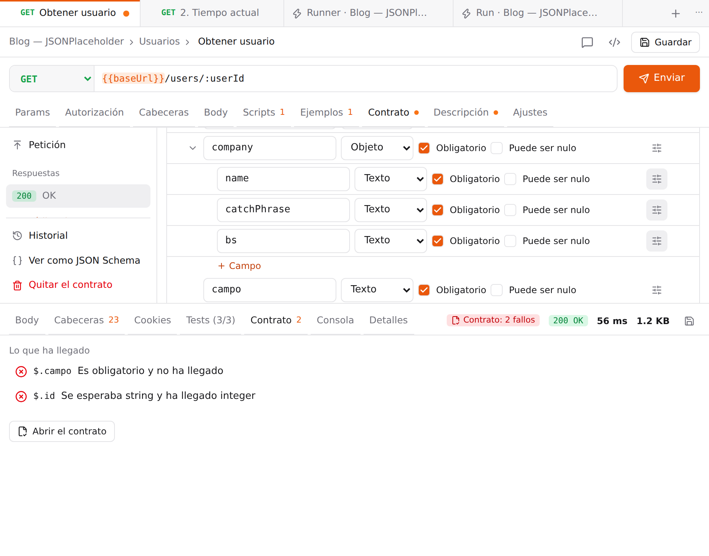<br><b>Comprobación del contrato</b> · cada envío se comprueba: lo enviado y lo recibido</td>
  </tr>
  <tr>
    <td width="50%" valign="top">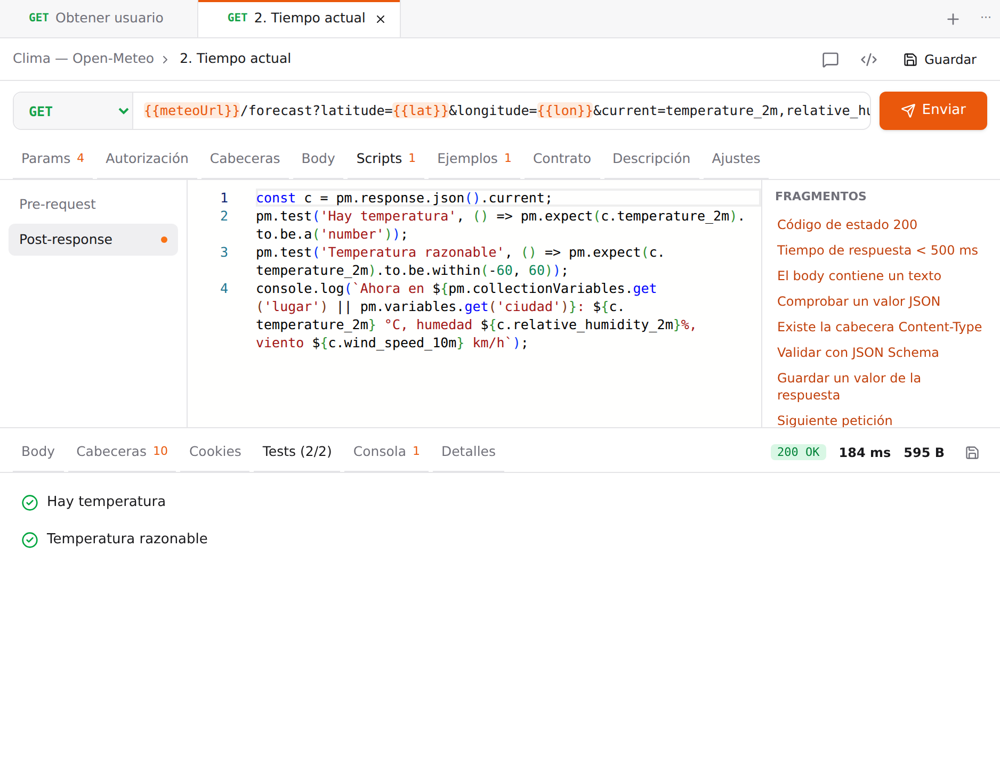<br><b>Tests y scripts</b> · la API <code>pm.*</code> con autocompletado y fragmentos</td>
    <td width="50%" valign="top">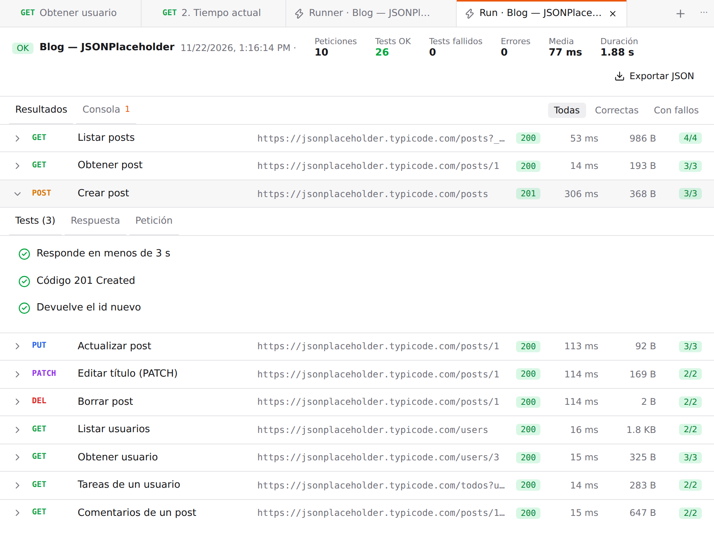<br><b>Runner de colecciones</b> · ejecuciones sin límites con resultados en vivo</td>
  </tr>
  <tr>
    <td width="50%" valign="top">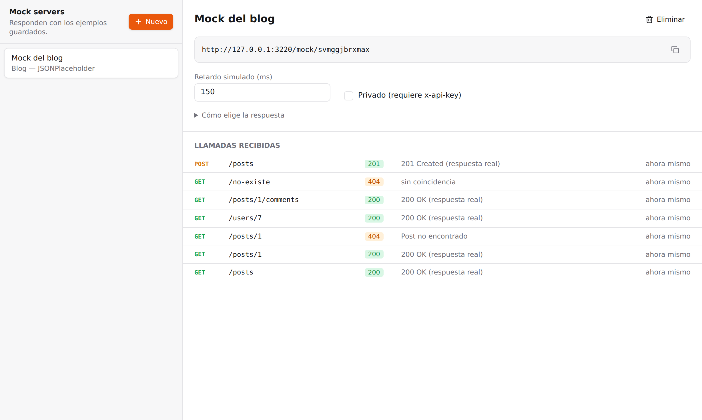<br><b>Mock servers</b> · con tus ejemplos o tus contratos, y registro de llamadas</td>
    <td width="50%" valign="top">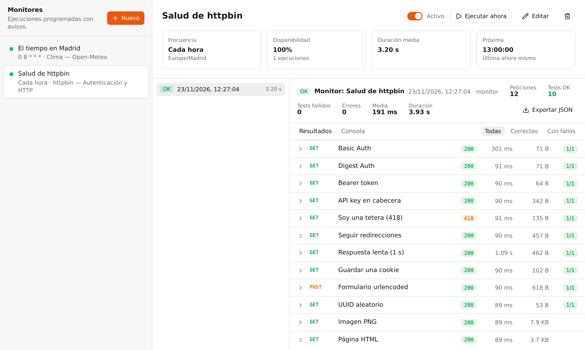<br><b>Monitores</b> · ejecuciones programadas con disponibilidad y avisos</td>
  </tr>
  <tr>
    <td width="50%" valign="top">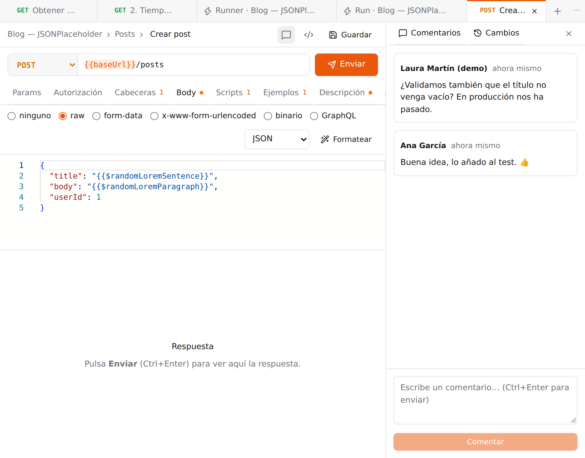<br><b>Equipos</b> · presencia, comentarios e historial de cambios</td>
    <td width="50%" valign="top">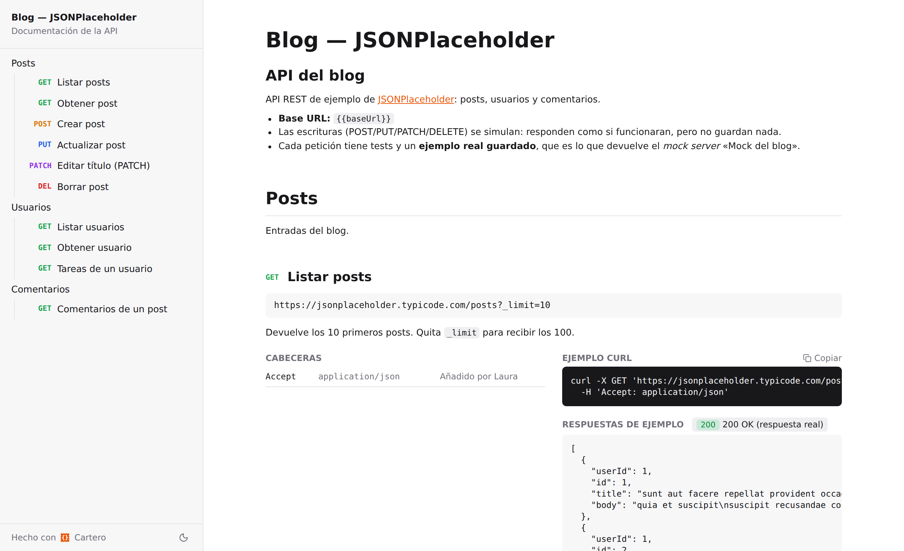<br><b>Documentación publicada</b> · una página pública por colección</td>
  </tr>
  <tr>
    <td width="50%" valign="top">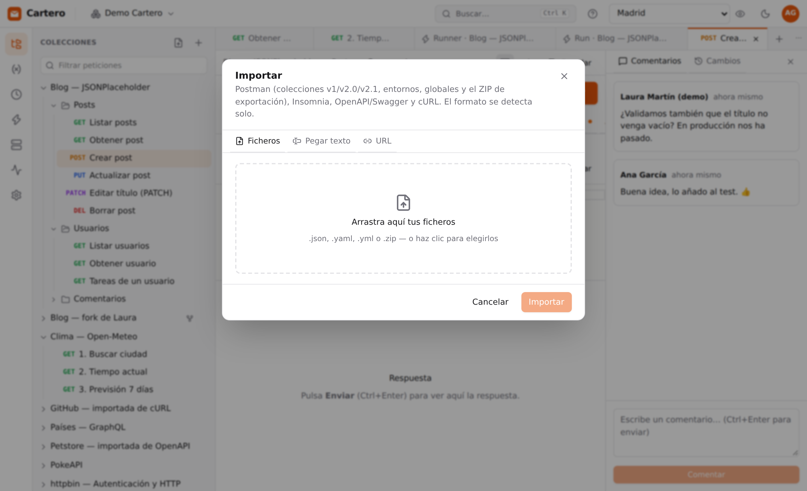<br><b>Importar</b> · Postman, Insomnia, OpenAPI y cURL</td>
    <td width="50%" valign="top">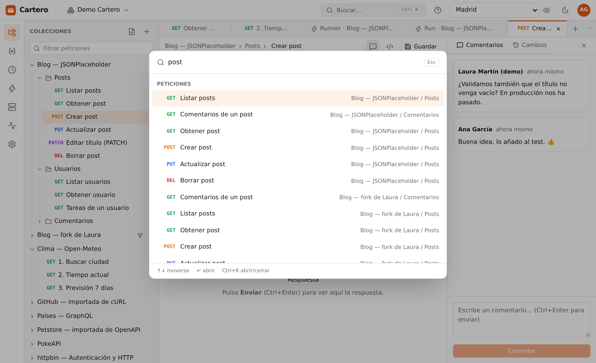<br><b>Paleta de comandos</b> · Ctrl+K encuentra cualquier petición o acción</td>
  </tr>
  <tr>
    <td width="50%" valign="top">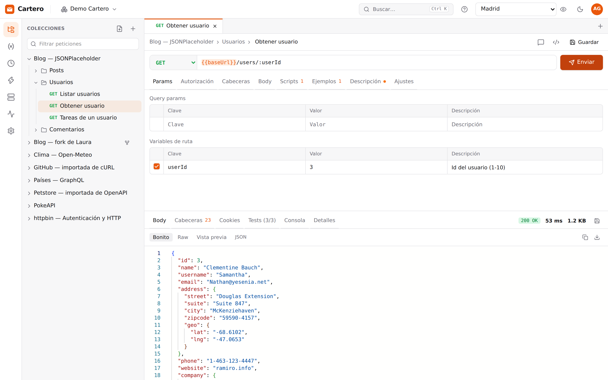<br><b>Tema claro</b> · toda la app, en claro y oscuro</td>
  </tr>
</table>

## Puesta en marcha

```bash
git clone https://github.com/elrincondeisma/cartero.git && cd cartero
cp .env.example .env        # cambia CARTERO_SECRET_KEY y POSTGRES_PASSWORD
docker compose up -d
```

Abre `http://localhost:3000`. El **asistente de instalación** te guía paso a paso: crear la cuenta de administrador, poner la URL pública, decidir quién puede registrarse y, si quieres, activar el login con Google y GitHub y el email. Lo tienes en [Primer arranque](docs/manual/es/15-autoalojamiento.md#primer-arranque-el-asistente).

**¿En AWS?** `pnpm deploy:aws` lanza un asistente paso a paso que despliega Cartero con CDK, en ECS Fargate o en una EC2, reutilizando tu VPC, base de datos, Redis y dominio o creándolos. Mira [Desplegar en AWS](docs/manual/es/20-desplegar-en-aws.md).

Todo lo que elijas se puede cambiar después en **Administración** (menú de la cuenta), junto con la gestión de usuarios. Mira la [guía de administración](docs/manual/es/17-administracion-y-login-social.md).

### Configuración

En el `.env` solo va lo que el servidor necesita **antes de arrancar**:

| Variable | Por defecto | Descripción |
|---|---|---|
| `CARTERO_SECRET_KEY` | — (obligatoria) | Clave para cifrar los secretos. Genera una con `openssl rand -base64 32` y **no la pierdas** |
| `DATABASE_URL` | — | PostgreSQL 14 o superior |
| `REDIS_URL` | — | Redis (para los monitores) |
| `ADMIN_EMAILS` | — | Cuentas que pasan a admin de la instancia en cada arranque, separadas por comas (sirve para recuperar el acceso) |
| `INLINE_WORKER` | `true` | `false` para ejecutar los monitores en un proceso aparte (`node dist/worker.js`) |

Todo lo demás se ajusta en **Administración**. Estas variables solo dan el valor inicial de una instancia nueva: `PUBLIC_URL`, `ALLOW_REGISTRATION`, `GOOGLE_CLIENT_ID` / `GOOGLE_CLIENT_SECRET`, `GITHUB_CLIENT_ID` / `GITHUB_CLIENT_SECRET`, `SMTP_URL` / `SMTP_FROM` y `BLOCK_PRIVATE_NETWORKS`.

> **Detrás de un proxy (Traefik, Caddy, Nginx):** reenvía también las conexiones WebSocket de `/api/ws`, que se usan para la presencia y los cambios en vivo.

## Conectar asistentes de IA (MCP)

En **Ajustes → Conectar IA (MCP)** creas un token y copias la configuración para tu cliente. Por ejemplo, en Claude Code:

```bash
claude mcp add --transport http cartero https://cartero.ejemplo.com/mcp --header "Authorization: Bearer crt_xxx"
```

Más detalles en el [manual](docs/manual/es/13-ia-mcp.md).

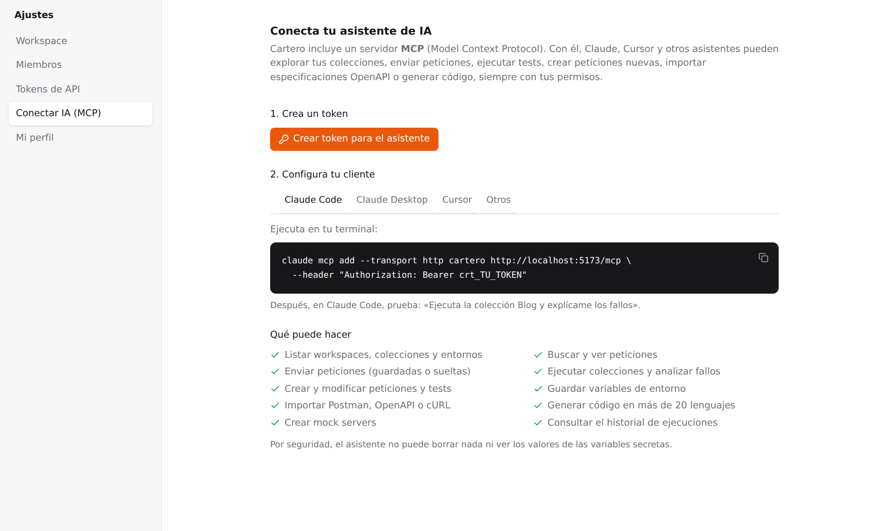

## App de escritorio

Una app nativa para macOS, Windows y Linux, escrita en Rust. Funciona sola (tus colecciones se guardan en tu ordenador y las peticiones salen de tu equipo, así que llegan a `localhost` y a tu VPN) y puede sincronizar workspaces con un servidor de Cartero. Descárgala en [Releases](https://github.com/elrincondeisma/cartero/releases) y lee la [guía](docs/manual/es/18-app-de-escritorio.md).

| macOS (Apple Silicon e Intel) | Windows | Linux |
|---|---|---|
| [⬇ Cartero-macos-universal.dmg](https://github.com/elrincondeisma/cartero/releases/latest/download/Cartero-macos-universal.dmg)<br>firmada y notarizada | [⬇ Cartero-windows-x64-setup.exe](https://github.com/elrincondeisma/cartero/releases/latest/download/Cartero-windows-x64-setup.exe) | [⬇ .deb](https://github.com/elrincondeisma/cartero/releases/latest/download/cartero-linux-amd64.deb) (Debian, Ubuntu)<br>[⬇ AppImage](https://github.com/elrincondeisma/cartero/releases/latest/download/Cartero-linux-x86_64.AppImage) (cualquier distribución) |

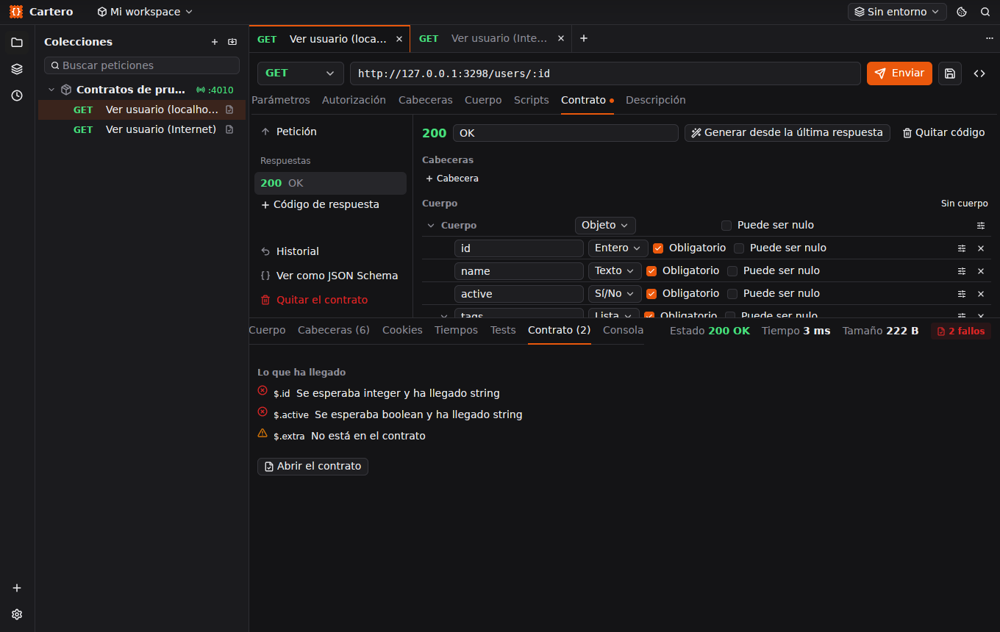

## CLI

```bash
# Ejecutar un fichero exportado de Postman con un entorno y datos
npx @cartero/cli run coleccion.postman_collection.json -e prod.postman_environment.json -d datos.csv -r cli,junit

# Ejecutar una colección de tu servidor y subir el resultado
CARTERO_SERVER=https://cartero.ejemplo.com CARTERO_TOKEN=crt_xxx \
  npx @cartero/cli run <id-coleccion> -e <id-entorno> --workspace <id-workspace> --report
```

Códigos de salida: `0` si todo pasa, `1` si falla algún test o petición, `2` si hay un error de uso.

## Arquitectura

```
apps/
  server/     Fastify + Drizzle (PostgreSQL) + BullMQ (Redis) + WebSocket
  web/        React 19 + Vite + Tailwind + TanStack Query + Monaco
  landing/    Web en Astro (español e inglés)
packages/
  core/       Modelo de datos (superconjunto de Postman Collection v2.1)
  executor/   Ejecución con postman-runtime en un proceso aislado (límites de tiempo y memoria)
  importers/  Postman, Insomnia, OpenAPI, cURL
  exporters/  Postman v2.1 y snippets de código
  cli/        cartero run
  mcp/        Servidor MCP (stdio y Streamable HTTP)
docs/manual/  Manual de uso en inglés; en español, docs/manual/es (también en /ayuda)
video/        Vídeo promocional (Remotion)
desktop/      App de escritorio nativa en Rust (GPUI): mira desktop/README.es.md
```

Las peticiones se envían **desde el servidor**. Así no hay problemas de CORS y puedes probar APIs de tu red local. Los scripts de usuario se ejecutan en un proceso hijo con límites de tiempo y memoria.

## Desarrollo

Requisitos: Node 22+, pnpm 12+ y Docker.

```bash
pnpm install
pnpm db:up                     # Postgres (5433) y Redis (6380) de desarrollo
pnpm --filter "./packages/*" build
pnpm --filter @cartero/server dev   # API en :3000
pnpm --filter @cartero/web dev      # Web en :5173
```

Tests:

```bash
pnpm test                      # unitarios e integración (necesita pnpm db:up)
npx playwright test            # E2E: levanta sus propias instancias aisladas (puertos 3201-3202), nunca tu base de datos de desarrollo
```

Lee [CONTRIBUTING.es.md](CONTRIBUTING.es.md) antes de mandar un PR.

## Licencia

[MIT](LICENSE). Cartero usa `postman-runtime`, `postman-collection`, `postman-collection-transformer`, `openapi-to-postmanv2` y `postman-code-generators`, todas con licencia Apache-2.0. Cartero no está afiliado a Postman, Inc.
