> 🌐 **English** · [Español](README.es.md)

# Cartero

[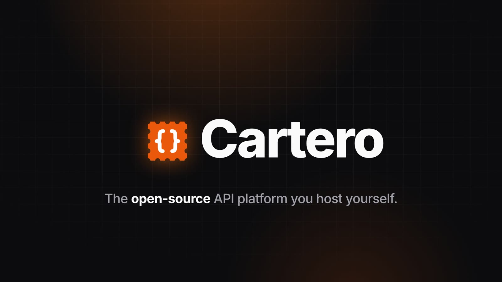](https://github.com/elrincondeisma/cartero/raw/main/apps/landing/public/video/cartero-en.mp4)

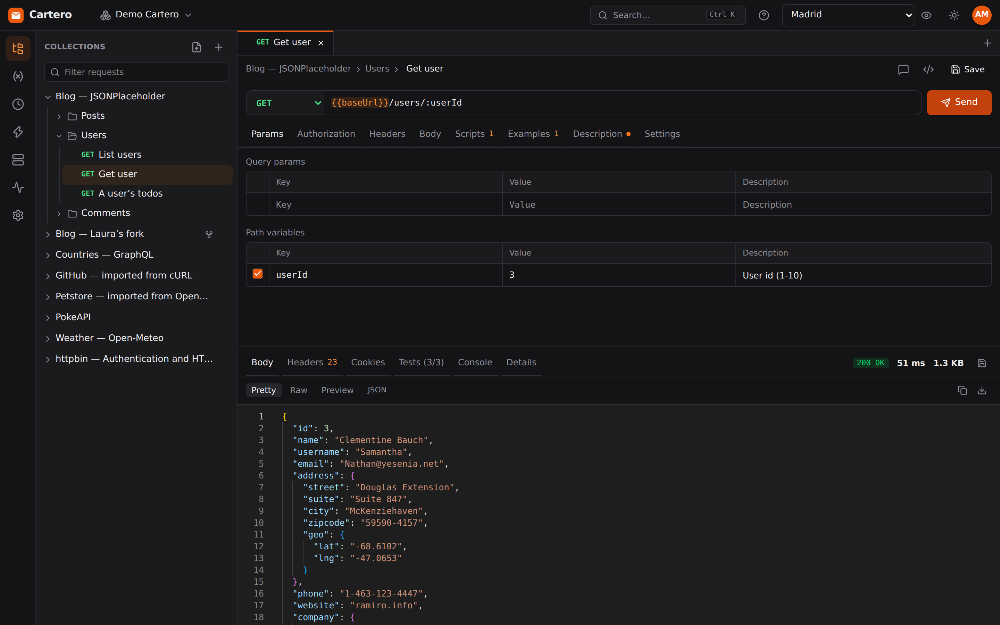

**Desktop app:** [macOS](https://github.com/elrincondeisma/cartero/releases/latest/download/Cartero-macos-universal.dmg) · [Windows](https://github.com/elrincondeisma/cartero/releases/latest/download/Cartero-windows-x64-setup.exe) · [Linux .deb](https://github.com/elrincondeisma/cartero/releases/latest/download/cartero-linux-amd64.deb) · [Linux AppImage](https://github.com/elrincondeisma/cartero/releases/latest/download/Cartero-linux-x86_64.AppImage)

**An open-source, self-hosted web API client.** A Postman alternative that includes what Postman charges for, free and without limits: collection runner, mock servers, monitors, published documentation and team collaboration. Import your Postman collections without losing anything.

> MIT · TypeScript · One `docker compose up` and you're done

## What's included

| | |
|---|---|
| **Requests** | REST and GraphQL; params, headers, body (raw/JSON/XML, form-data with files, urlencoded, binary); history; cookies; code snippets in 20+ languages |
| **Authentication** | Basic, Bearer, API Key, JWT, Digest, OAuth 1.0, **OAuth 2.0** (Authorization Code + PKCE, Client Credentials, Password, Implicit, refresh), Hawk, AWS SigV4, NTLM, Akamai EdgeGrid; inherited folder → collection |
| **Scripts** | Pre-request and post-response scripts with Postman's `pm.*` API (run by `postman-runtime`): `pm.test`, `pm.expect`, `pm.sendRequest`, `pm.environment`, `setNextRequest`… with autocomplete |
| **Variables** | Global, collection, folder, environment and iteration data. Secret variables are encrypted at rest (AES-256-GCM) |
| **Import / export** | Postman (v1, v2.0 and v2.1 collections, environments, globals, data dumps and export ZIPs), Insomnia (v4 JSON and v5 YAML), OpenAPI 3.0/3.1, Swagger 2.0 and cURL. Exports to Postman v2.1 (lossless round trip) |
| **Runner** | Run collections or folders without limits, with iterations, CSV/JSON data, delay, "stop on first failure" and live results |
| **CLI** | `cartero run`, a Newman equivalent for CI: console, JSON, JUnit and HTML reporters; runs files or collections from your server and uploads the result |
| **Contracts** | The structure the frontend sends and the backend must return, per status code. Generated from a real response or written by hand; checked on every send, breaking changes flagged on save, mocks built from it, OpenAPI 3.1 export and import. See the [guide](https://cartero.elrincondeisma.com/docs/contracts/) |
| **Mock servers** | Respond with your saved examples: routes with parameters, `x-mock-response-*` headers, dynamic variables (`{{$randomEmail}}`…), simulated latency, private mocks and a call log |
| **Monitors** | Scheduled runs with cron and time zone; alerts via Slack, Discord, Telegram, email or webhook; history with uptime and timings |
| **Documentation** | A public page per collection with Markdown descriptions, examples and cURL. Optional password. Credentials are hidden automatically |
| **AI (MCP)** | Built-in MCP server (`/mcp`) with 24 tools: Claude, Cursor and other assistants can browse, send, run, create requests, import and manage contracts, with your permissions |
| **Languages** | UI, user guide and sample data in **English and Spanish**, with a language switch saved to your account |
| **Help** | Welcome wizard, guided tour, command palette (Ctrl+K), [full user guide](https://cartero.elrincondeisma.com/docs/) at `/ayuda` and sample data with real APIs that you can remove in one click |
| **Teams** | Workspaces, invitations, roles (owner, admin, editor, viewer), real-time presence, comments, change history with restore, fork and merge, API tokens |
| **Sign-in and admin** | Email and password, **Google** and **GitHub**. Step-by-step **setup wizard** on first start, and an admin panel for every setting: accounts and roles, sign-up, OAuth, email (SMTP) and SSRF protection |

## Screenshots

<table>
  <tr>
    <td width="50%" valign="top">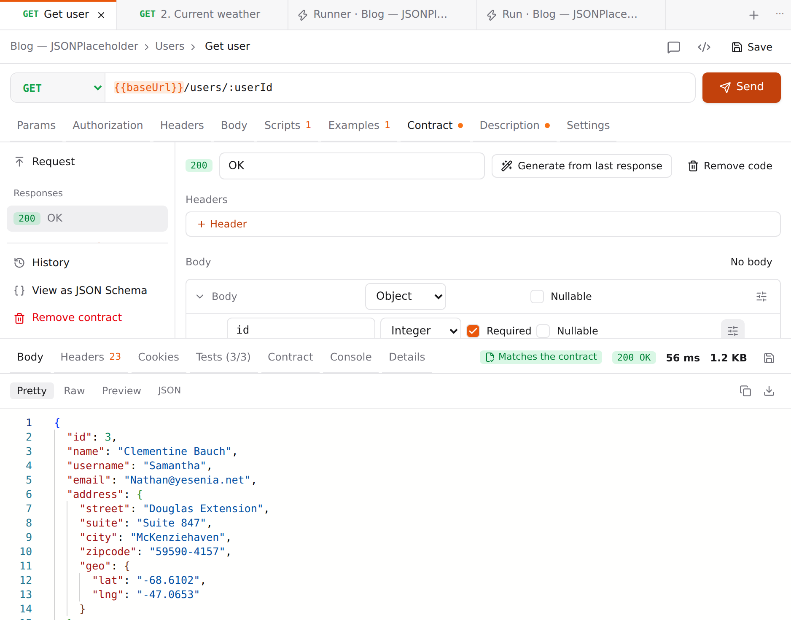<br><b>API contracts</b> · generated from a real response, edited as a field tree</td>
    <td width="50%" valign="top">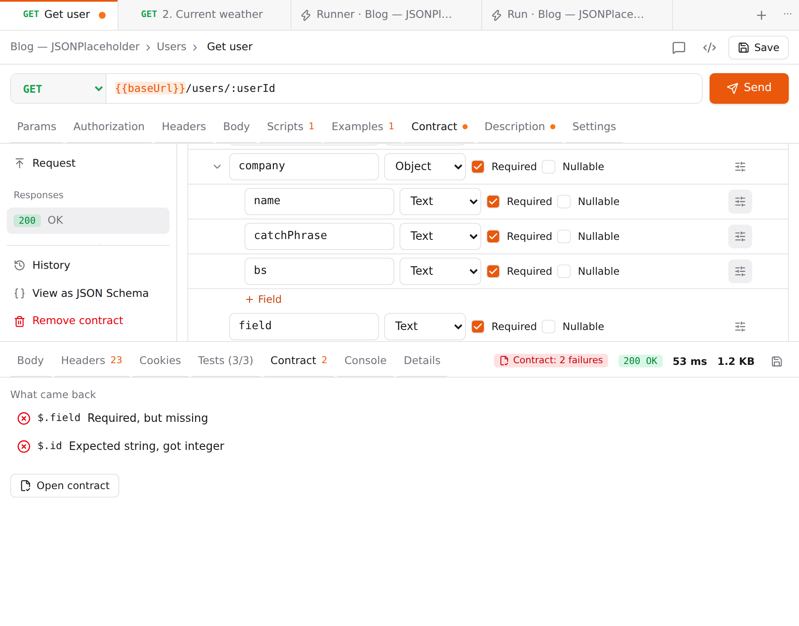<br><b>Contract checks</b> · every send is checked: what was sent and what came back</td>
  </tr>
  <tr>
    <td width="50%" valign="top">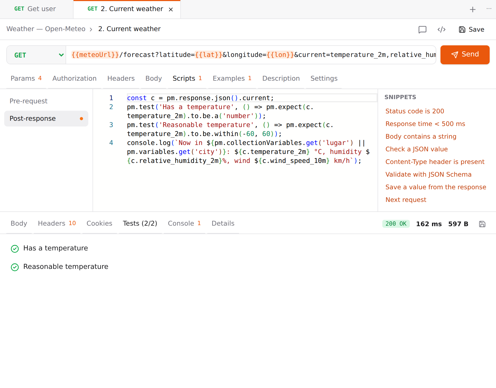<br><b>Tests and scripts</b> · the <code>pm.*</code> API with autocomplete and snippets</td>
    <td width="50%" valign="top">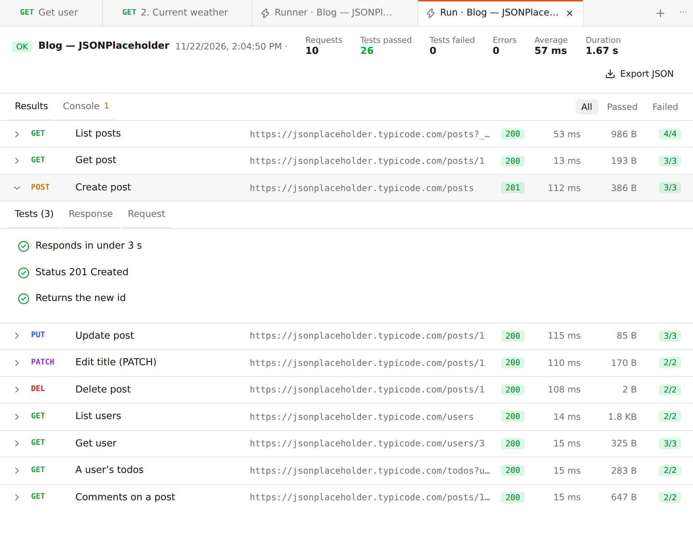<br><b>Collection runner</b> · unlimited runs with live results</td>
  </tr>
  <tr>
    <td width="50%" valign="top">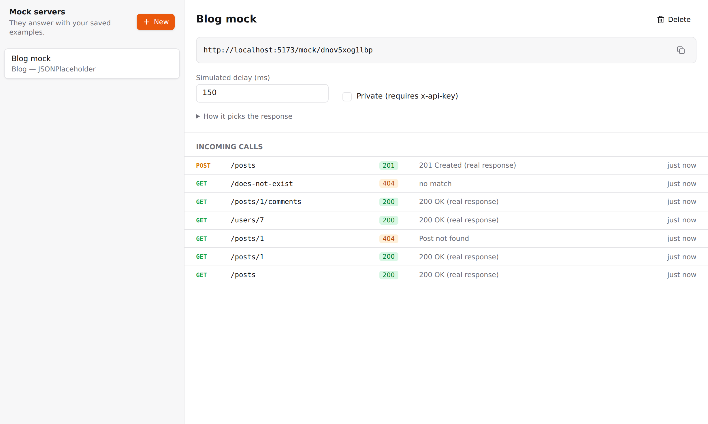<br><b>Mock servers</b> · from saved examples or contracts, with a call log</td>
    <td width="50%" valign="top">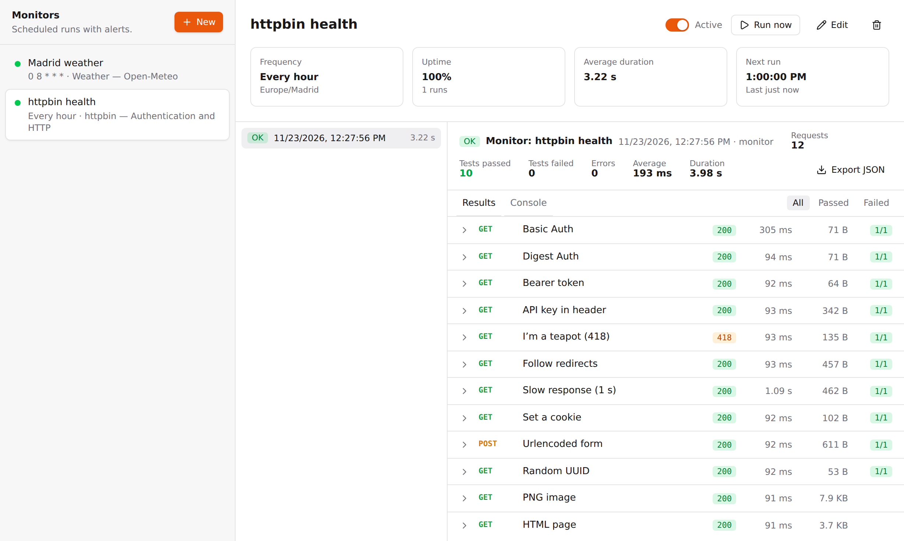<br><b>Monitors</b> · scheduled runs with uptime and alerts</td>
  </tr>
  <tr>
    <td width="50%" valign="top">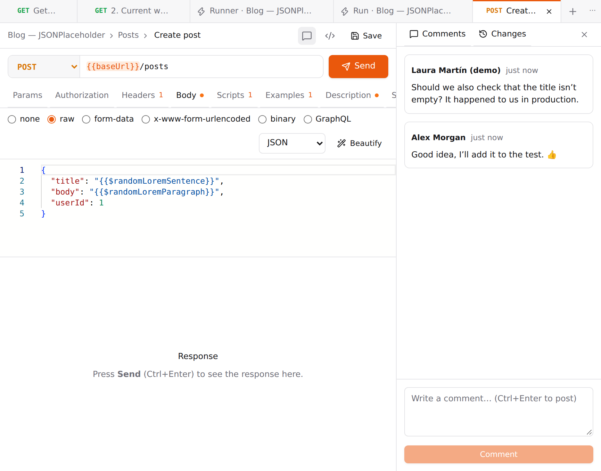<br><b>Teams</b> · presence, comments and change history</td>
    <td width="50%" valign="top">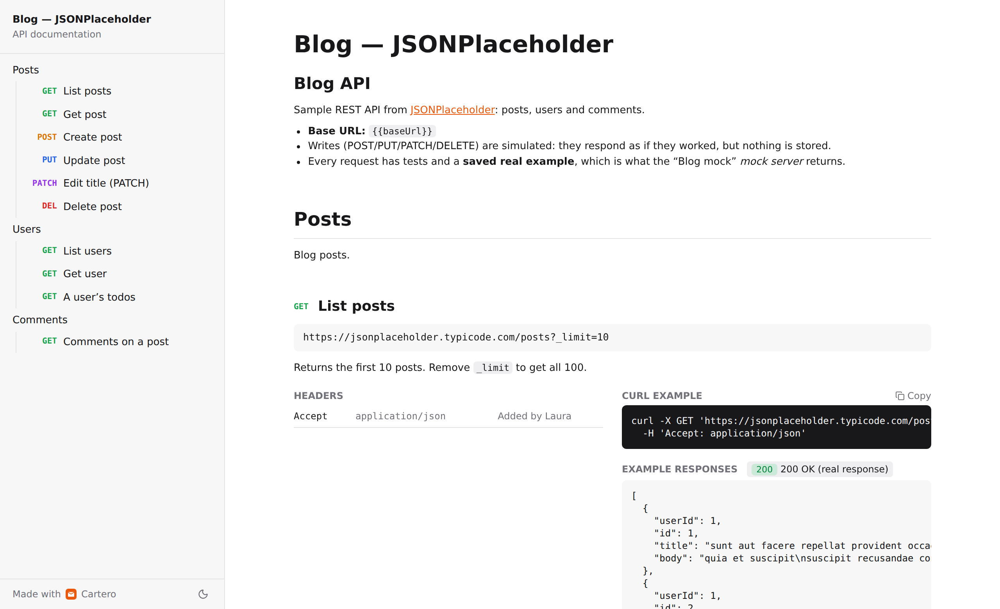<br><b>Published docs</b> · one public page per collection</td>
  </tr>
  <tr>
    <td width="50%" valign="top">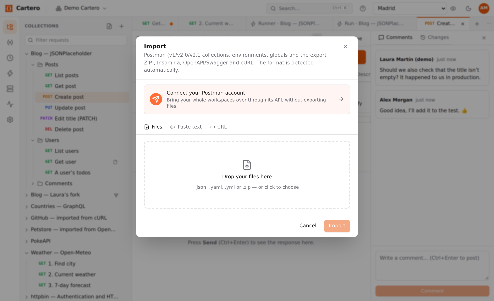<br><b>Import</b> · Postman, Insomnia, OpenAPI and cURL</td>
    <td width="50%" valign="top">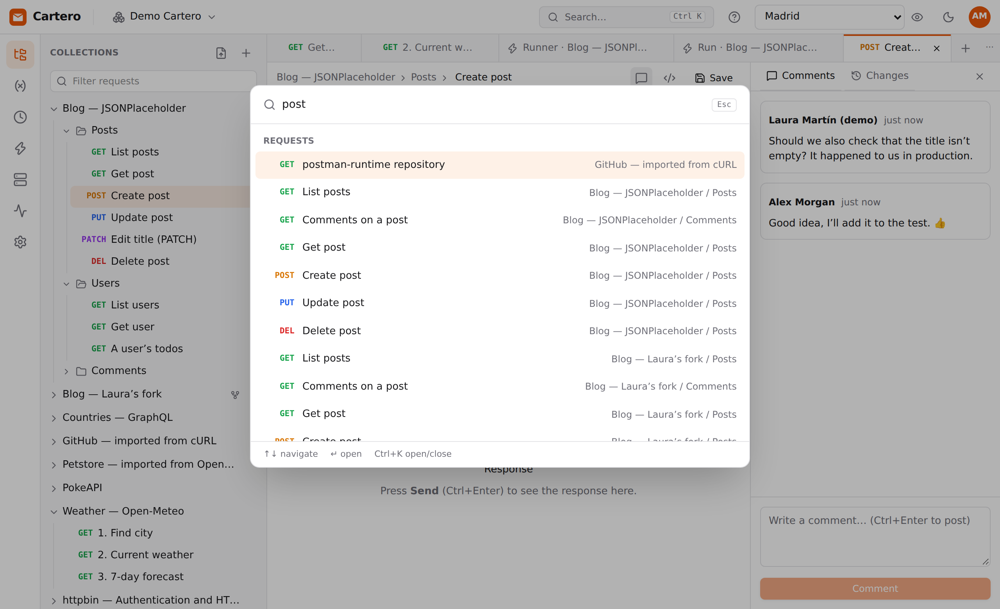<br><b>Command palette</b> · Ctrl+K finds any request or action</td>
  </tr>
  <tr>
    <td width="50%" valign="top">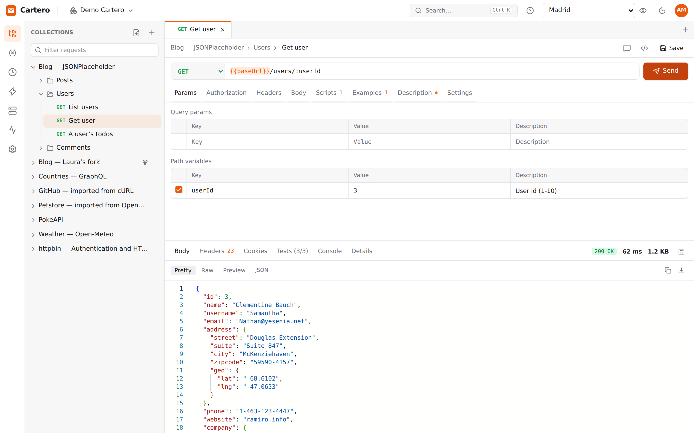<br><b>Light theme</b> · the whole app, in light and dark</td>
  </tr>
</table>

## Getting started

```bash
git clone https://github.com/elrincondeisma/cartero.git && cd cartero
cp .env.example .env        # change CARTERO_SECRET_KEY and POSTGRES_PASSWORD
docker compose up -d
```

Open `http://localhost:3000`. The **setup wizard** walks you through it step by step: create the admin account, set the public URL, decide who can sign up, and optionally turn on Google and GitHub sign-in and email. See [First start](https://cartero.elrincondeisma.com/docs/self-hosting/#first-start-the-setup-wizard).

**On AWS?** `pnpm deploy:aws` starts a step-by-step wizard that deploys Cartero with CDK, on ECS Fargate or on an EC2 instance, reusing your VPC, database, Redis and domain or creating them. See [Deploying to AWS](https://cartero.elrincondeisma.com/docs/deploy-aws/).

Everything you choose can be changed later in **Administration** (account menu), along with user management. See the [admin guide](https://cartero.elrincondeisma.com/docs/admin-and-social-login/).

### Configuration

Only what the server needs **before it starts** goes in `.env`:

| Variable | Default | Description |
|---|---|---|
| `CARTERO_SECRET_KEY` | — (required) | Key used to encrypt secrets. Generate one with `openssl rand -base64 32` and **don't lose it** |
| `DATABASE_URL` | — | PostgreSQL 14 or later |
| `REDIS_URL` | — | Redis (for monitors) |
| `ADMIN_EMAILS` | — | Accounts that become instance admins at every start, comma-separated (useful to recover access) |
| `INLINE_WORKER` | `true` | `false` to run monitors in a separate process (`node dist/worker.js`) |

Everything else is set in **Administration**. These variables only provide the initial value for a new instance: `PUBLIC_URL`, `ALLOW_REGISTRATION`, `GOOGLE_CLIENT_ID` / `GOOGLE_CLIENT_SECRET`, `GITHUB_CLIENT_ID` / `GITHUB_CLIENT_SECRET`, `SMTP_URL` / `SMTP_FROM` and `BLOCK_PRIVATE_NETWORKS`.

> **Behind a proxy (Traefik, Caddy, Nginx):** also forward the WebSocket connections on `/api/ws`, used for presence and live changes.

## Connect AI assistants (MCP)

In **Settings → Connect AI (MCP)** you create a token and copy the configuration for your client. For example, in Claude Code:

```bash
claude mcp add --transport http cartero https://cartero.example.com/mcp --header "Authorization: Bearer crt_xxx"
```

More in the [user guide](https://cartero.elrincondeisma.com/docs/ai-mcp/).

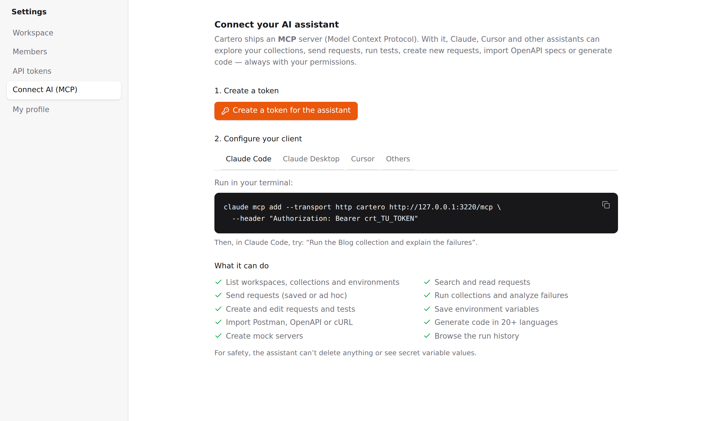

## Desktop app

A native app for macOS, Windows and Linux, written in Rust. It works on its own (your collections live on your computer and requests leave from your machine, so they reach `localhost` and your VPN) and can sync workspaces with a Cartero server. Download it from [Releases](https://github.com/elrincondeisma/cartero/releases) and read the [guide](https://cartero.elrincondeisma.com/docs/desktop-app/).

| macOS (Apple Silicon and Intel) | Windows | Linux |
|---|---|---|
| [⬇ Cartero-macos-universal.dmg](https://github.com/elrincondeisma/cartero/releases/latest/download/Cartero-macos-universal.dmg)<br>signed and notarized | [⬇ Cartero-windows-x64-setup.exe](https://github.com/elrincondeisma/cartero/releases/latest/download/Cartero-windows-x64-setup.exe) | [⬇ .deb](https://github.com/elrincondeisma/cartero/releases/latest/download/cartero-linux-amd64.deb) (Debian, Ubuntu)<br>[⬇ AppImage](https://github.com/elrincondeisma/cartero/releases/latest/download/Cartero-linux-x86_64.AppImage) (any distribution) |

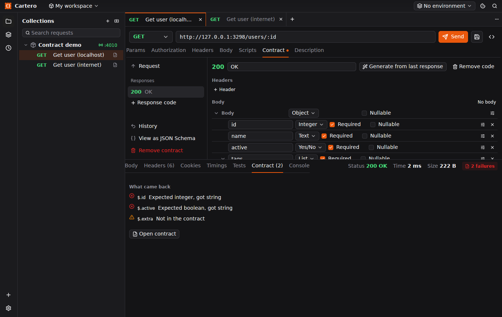

## CLI

```bash
# Run an exported Postman file with an environment and data
npx @cartero/cli run collection.postman_collection.json -e prod.postman_environment.json -d data.csv -r cli,junit

# Run a collection from your server and upload the result
CARTERO_SERVER=https://cartero.example.com CARTERO_TOKEN=crt_xxx \
  npx @cartero/cli run <collection-id> -e <environment-id> --workspace <workspace-id> --report
```

Exit codes: `0` if everything passes, `1` if a test or request fails, `2` on a usage error.

## Architecture

```
apps/
  server/     Fastify + Drizzle (PostgreSQL) + BullMQ (Redis) + WebSocket
  web/        React 19 + Vite + Tailwind + TanStack Query + Monaco
  landing/    Astro website (English and Spanish)
packages/
  core/       Data model (a superset of Postman Collection v2.1)
  executor/   Runs requests with postman-runtime in an isolated process (time and memory limits)
  importers/  Postman, Insomnia, OpenAPI, cURL
  exporters/  Postman v2.1 and code snippets
  cli/        cartero run
  mcp/        MCP server (stdio and Streamable HTTP)
docs/manual/  User guide in English; Spanish in docs/manual/es (also served at /ayuda and at cartero.elrincondeisma.com/docs)
video/        Promo video (Remotion)
desktop/      Native desktop app in Rust (GPUI): see desktop/README.md
```

Requests are sent **from the server**. That means no CORS problems, and you can test APIs on your local network. User scripts run in a child process with time and memory limits.

## Development

Requirements: Node 22+, pnpm 12+ and Docker.

```bash
pnpm install
pnpm db:up                     # development Postgres (5433) and Redis (6380)
pnpm --filter "./packages/*" build
pnpm --filter @cartero/server dev   # API on :3000
pnpm --filter @cartero/web dev      # Web on :5173
```

Tests:

```bash
pnpm test                      # unit and integration (needs pnpm db:up)
npx playwright test            # E2E: starts its own isolated instances (ports 3201-3202), never your dev database
```

Read [CONTRIBUTING.md](CONTRIBUTING.md) before sending a PR.

## License

[MIT](LICENSE). Cartero uses `postman-runtime`, `postman-collection`, `postman-collection-transformer`, `openapi-to-postmanv2` and `postman-code-generators`, all licensed under Apache-2.0. Cartero is not affiliated with Postman, Inc.
